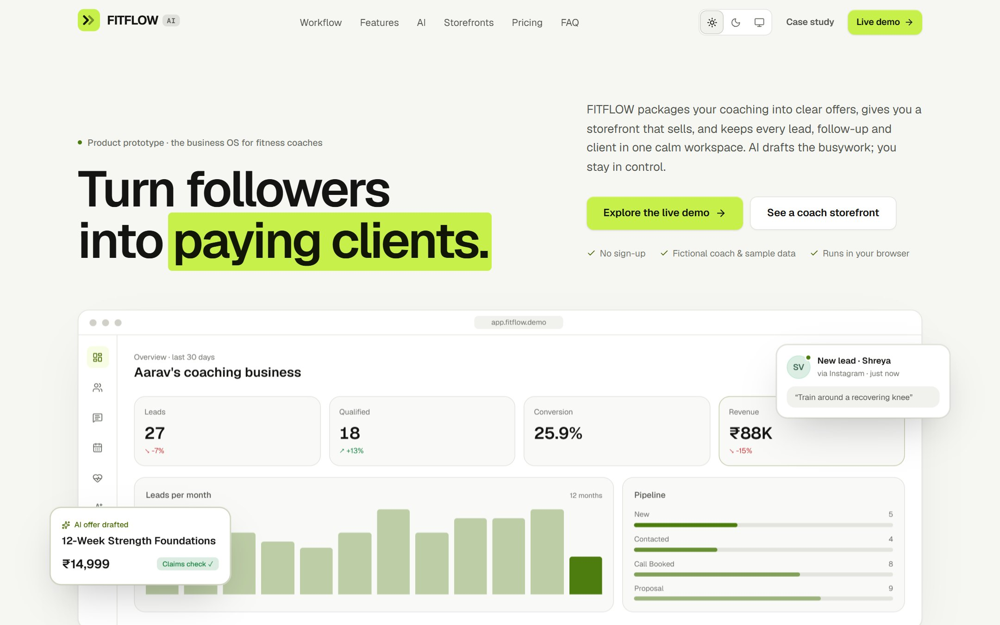

# FITFLOW AI: business OS for fitness coaches (product prototype)

An interactive SaaS product prototype that helps independent fitness coaches turn an online audience into paying clients. It covers an AI offer builder, coaching storefronts, a lead CRM, AI follow-ups, bookings, client tracking, analytics and an AI business assistant.

> **Portfolio project.** Fictional coach, sample data, simulated AI. There is no backend, no accounts, no payments and no messages are ever sent. Everything runs in the browser.



## Try it

| | |
|---|---|
| Landing page | `/` |
| Live demo (dashboard) | `/app` |
| Coach storefront, “Forge” theme | `/s/aarav` |
| Coach storefront, “Bloom” theme | `/s/meera` |
| Case study | `/case-study` |
| Figma file | [FITFLOW AI — Product Design](https://www.figma.com/design/tplM1llRbk13QxwC9bzAxU) |

Things worth clicking: drag a lead across the pipeline, create an offer with the AI builder and publish it, send an enquiry from Aarav's storefront and watch it arrive as a lead, restyle the storefront and see the 3D preview update, ask the assistant “What should I improve this week?”. Press <kbd>Ctrl/⌘ K</kbd> anywhere in the app.

## Product overview

**Target user:** independent fitness coaches, personal trainers and fitness creators who sell coaching online or in person and currently run their business from Instagram DMs, WhatsApp and spreadsheets.

**Problem (design hypotheses):** leads are scattered across channels, follow-ups get forgotten, offers are hard to explain (“DM me for price”), and there's no visibility into which channels or programs produce clients.

**Value proposition:** *Turn followers into paying clients.* FITFLOW follows the path a follower takes (attract → capture → follow up → convert & coach) and gives the coach one tool for each step.

| Feature | What it does |
|---|---|
| Overview | KPIs with period-over-period deltas, performance trend, open pipeline, AI insights, upcoming sessions, follow-ups due, activity feed |
| AI Offer Builder | 5-step guided flow (goal, audience, format, price with guidance) → simulated generation → editable draft with claims check → live card/storefront preview → publish |
| Storefront builder | Two themes, content editing, section toggles, program selection; desktop, mobile and layered 3D previews; public pages at `/s/*` |
| Leads CRM | Drag-and-drop pipeline, list view with sort/filter/search, “Due” view, editable lead panel with stage stepper, notes and timeline |
| Follow-ups | Pick a lead, goal, tone and channel → streamed draft → edit, copy, save or log as sent |
| Bookings | Week calendar with overlap lanes and click-to-book, agenda view, create/edit with conflict warnings, status updates |
| Clients | Program progress, metrics, adherence chart, coaching plan phases, check-in logging that recalculates status |
| Analytics | Range and source filters (in the URL) driving KPIs, acquisition and revenue charts, cohort funnel, source and offer performance, monthly comparison, metric definitions |
| Assistant | Suggested prompts and free text; answers computed from the same data, with links to the relevant screen |

## Design system

- **Themes:** light and dark, following the OS by default with a Light / Dark / System toggle (saved in localStorage, applied before first paint). Every colour is a CSS variable in `src/app/globals.css`, mirrored 1:1 by the `color/*` variables in the Figma file.
- **Colour:** warm-neutral surfaces, hairline borders, a three-tier text scale and one lime accent (`#C8F04A`) reserved for primary actions and selection; data colours are separate tokens validated per theme.
- **Type:** Geist throughout (display to caption, tabular numbers), Geist Mono for code-like labels; Fraunces only for the Bloom storefront theme.
- **Components:** `src/components/ui` (buttons, fields, segmented controls, badges, drawer, menu, dialog, toast, tooltip, progress ring, sparkline, empty states, skeletons) and `src/components/charts.tsx`.
- **Motion:** one easing curve and one spring preset (`src/components/motion/kit.tsx`). Staggered entrances, sliding tab indicators, counting numbers, chart draw-ins, drawer/modal transitions and an AI generation sequence. Respects `prefers-reduced-motion`.
- **Scroll choreography (GSAP):** SplitText masked headline reveal and a pinned, scroll-scrubbed “How it works” sequence (ScrollTrigger with snapping) that swaps live product visuals per step.
- **3D:** restrained CSS 3D transforms with spring parallax (hero product shot, storefront showcase, offer preview). WebGL was deliberately not used; see the case study.

## Tech stack

Figma (variables, styles, components) · Next.js 15 (App Router) · React 19 · TypeScript · Tailwind CSS 3 (with container queries) · GSAP + ScrollTrigger + SplitText · Motion (Framer Motion) · Recharts · Zustand (persisted to localStorage) · NumberFlow · Lucide icons. Photography from Unsplash.

## Project structure

```
src/app/                 routes: landing, /app/* (dashboard), /s/[slug] (storefronts), /case-study
src/components/landing/  landing sections, 3D hero, live feature demos
src/components/app/      app shell, sidebar, palette, forms, welcome tour
src/components/screens/  one file per dashboard screen
src/components/storefront/  storefront renderer (container queries) and device frames
src/lib/seed.ts          deterministic sample-data generator (dates relative to today)
src/lib/store.ts         Zustand store: data + every action, persisted to localStorage
src/lib/analytics.ts     pure metric functions shared by all screens
src/lib/ai.ts            simulated AI: offer drafts, follow-ups, assistant answers, claims check
tests/                   unit tests (logic) and an interaction test (browser)
scripts/screenshots.mjs  regenerates public/screens
```

## Run locally

```bash
npm install
npm run dev          # http://localhost:3200
```

```bash
npm run check        # typecheck + lint + unit tests
npm run build        # production build (all routes are static)
npm run test:e2e     # interaction test against a running server (needs Chrome; set CHROME_PATH)
node scripts/screenshots.mjs   # refresh portfolio screenshots
```

No environment variables or API keys are needed.

## Deploy

Every route is pre-rendered, so any static-capable host works. On Vercel: import the repo (framework: Next.js, default settings) or run `npx vercel --prod`. No services, databases or secrets are required.

## Limitations (honest list)

- No backend: data is fictional and lives in the visitor's browser; “Reset” regenerates it.
- AI is simulated with templates over the sample data; no model is called.
- No user research or usability testing yet; problem statements and persona are hypotheses.
- Pricing is a packaging concept; nothing is for sale and no payments exist.
- Pipeline drag-and-drop uses native HTML drag events (mouse); on touch, stages change from the lead panel.
- People in the Unsplash photos are not the fictional coaches named in the demo.

See [`/case-study`](src/app/case-study/page.tsx) and [docs/CASE_STUDY.md](docs/CASE_STUDY.md) for the design rationale.
